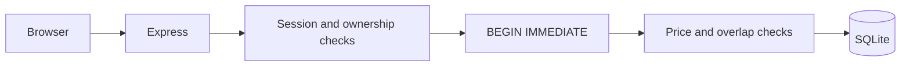

# Seatly — Workspace Booking

Find a workspace and reserve a time slot, with guest requests and owner confirmation.

[Browser-only demo](https://memorim.github.io/seatly-workspace-booking/) · [Hosted sandbox](https://memorim-flowboard-live.amusedcorgi34.chatgpt.site/seatly/index.html)

The browser-only build stores data locally. The hosted sandbox is a separate revision/deployment; new local audit guarantees are described below.


[Short interaction recording](docs/demo.gif)

## Implemented

- Search, district/type/capacity filters and favourites.
- Server-priced reservations, 30-minute pending holds, owner confirmation, rescheduling and cancellation.
- Guest/owner accounts, cookie sessions, private reservation lists and paginated API responses.

## Stack and architecture

React, TypeScript and Vite; Express, Zod and built-in Node SQLite.



## Technical mechanisms and security

- `server/app.ts` takes a SQLite `BEGIN IMMEDIATE` write lock before reading the idempotency key, room capacity and price. Creation and the saved retry response commit together.
- Insert/update overlap triggers reject intersecting pending/confirmed intervals. Adjacent intervals are allowed. Separate HTTP servers sharing a SQLite file are tested, rather than only requests handled by one synchronous connection.
- `server/booking-constraints.sql` also rejects malformed calendar dates, invalid time intervals, excessive capacity and non-positive prices for active bookings. These guards do not rewrite historical rows.
- The server computes the amount from the stored room price and minute duration; client-supplied totals are not accepted. Reservation ownership and owner-only confirmation are checked on the server.
- The standalone backend intentionally retains published local demo identities; it rejects production mode, non-loopback HOST and remote/rebinding requests. Native Sites identity is a separate adapter. Passwords use scrypt. Random session tokens are stored as SHA-256 hashes; cookies are HttpOnly/SameSite=Strict, and logout revokes the session. Cross-origin writes are rejected.

## Local setup

Node.js 24.18.0 and pnpm 11.7.0 (see version files).

```bash
npm install --global pnpm@11.7.0
pnpm install --frozen-lockfile
pnpm build
pnpm start
```

Open `http://localhost:4200`. For live UI development use `pnpm dev` where available. The API binds to `127.0.0.1` by default.

## Configuration

Configure process environment variables using [.env.example](.env.example). `pnpm start` uses the process environment; it does not implicitly load that file. To load a copied `.env` explicitly, run `node --env-file=.env --import tsx server/index.ts`.

## Database and upgrades

SQLite is stored at `data/seatly.db`. Initialization creates/migrates the schema; sample rows are included for local use. Back up the database before upgrades. Do not remove the database as a migration step.

## Verification

```bash
pnpm lint
pnpm format:check
pnpm test
pnpm test:contract
pnpm test:upgrade
pnpm typecheck
pnpm build
pnpm exec playwright install chromium firefox webkit
pnpm test:e2e
pnpm audit --audit-level=high
```

`tests/concurrency.test.ts`: independent SQLite connections and HTTP servers, overlap rejection and identical-key replay. `tests/audit.test.ts`: direct SQL validation and rollback after response persistence fails. `tests/expiry-restart.test.ts` additionally verifies idle cleanup with a controlled clock, stop/error handling, a real second-connection SQLite lock, safe 503/retry, persisted session/idempotency after reopen, and an expired slot becoming bookable. Existing rescheduling, backup and browser tests remain.

CI installs locked dependencies, checks lint/format, types, unit/API, contract, upgrade, browser engines and build, and scans dependency advisories. A passing scanner is time-specific.

## Limits and next steps

- Published accounts are limited to a local demonstration. The standalone entry point fails closed for production or non-loopback HOST before opening the database. Real-customer deployment needs separate account provisioning, transport/security configuration and operational review; setting a different HOST is deliberately insufficient.
- Booking times use a single fixed Moscow UTC+03:00 zone; multi-zone/DST bookings are not implemented. Prices are rounded to whole roubles. There are no payments.
- Expired holds are released on API activity and by an idempotent 30-second idle timer in the standalone server. Startup performs a pass; shutdown clears the timer. API correctness does not depend on timer punctuality. Direct SQL writers still need the shared expiry pass before slot allocation. SQLite uses one writer and a 5-second busy timeout; contention returns 503 without partially consuming a request key. This is not a claim about arbitrary distributed replicas.
- The hosted D1 adapter is a separate deployment. This audit changes the local Node/SQLite implementation and repository extracts; it does not publish a new native Site version.

## Further documentation

[Audit findings and follow-up](docs/AUDIT_2026_10.md) · [Technical reference](docs/TECHNICAL.md) · [Change history](CHANGELOG.md)

[API request/response example](docs/API_EXAMPLE.md)

[Scheduled backups and recovery](docs/SCHEDULED_BACKUPS.md) · [Hosted adapter](hosting/README.md)

[Revision and deployment checks](docs/DEPLOYMENT_CHECKS.md) — read-only `pnpm smoke` verifies a running Node API and an optional expected source SHA.
